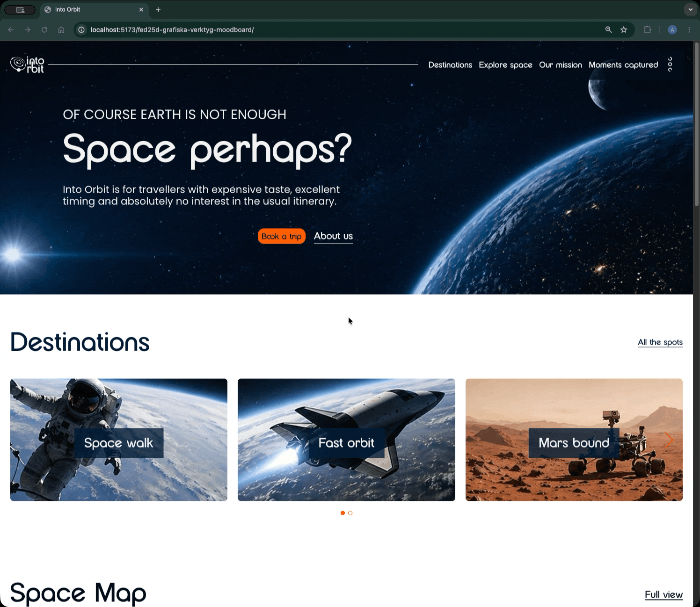
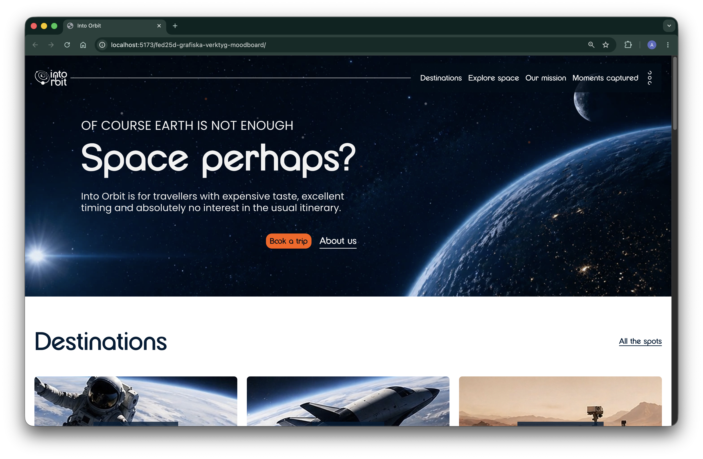
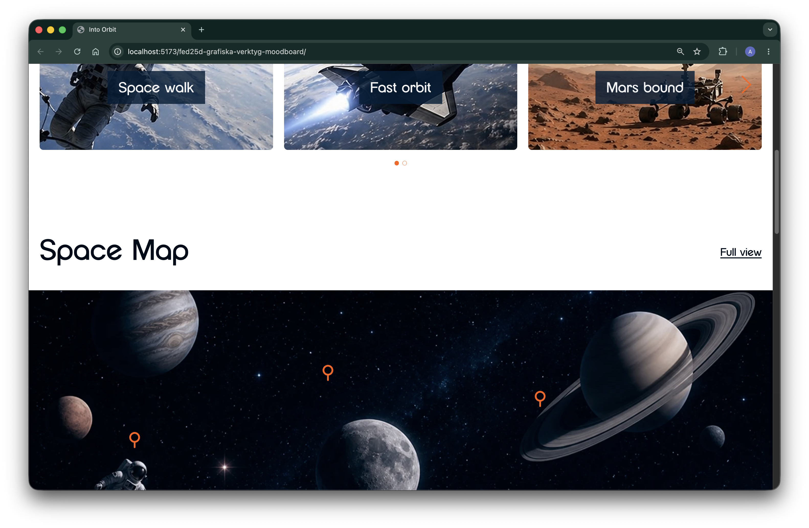
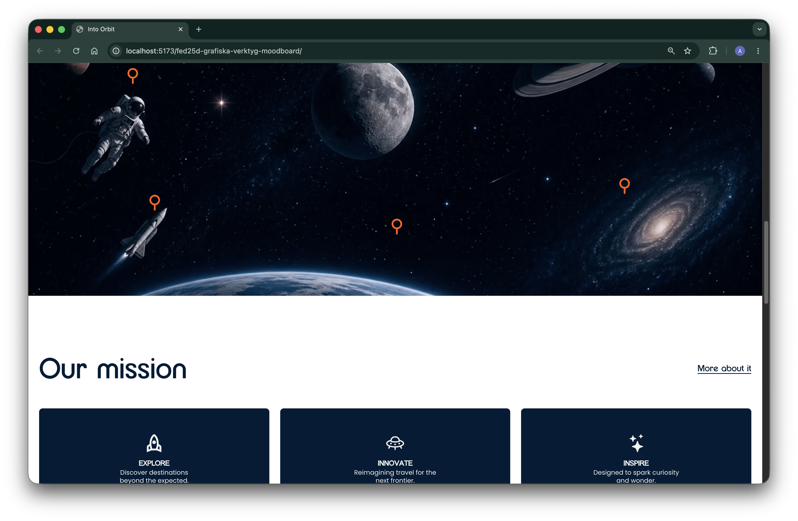
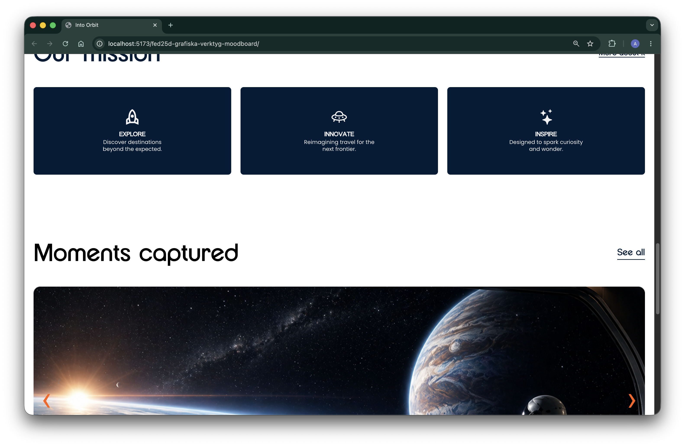
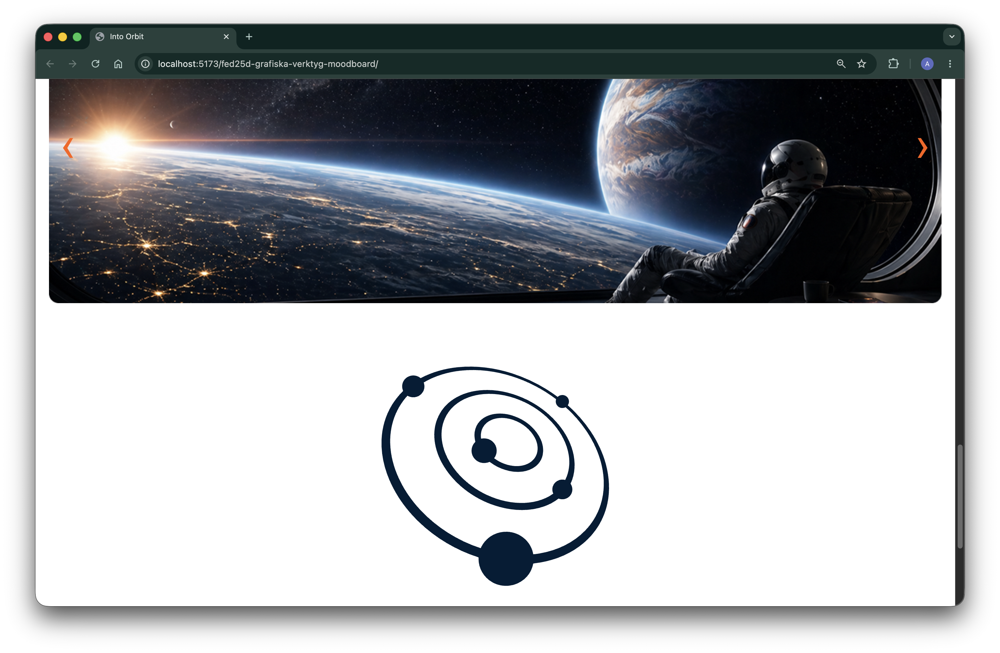
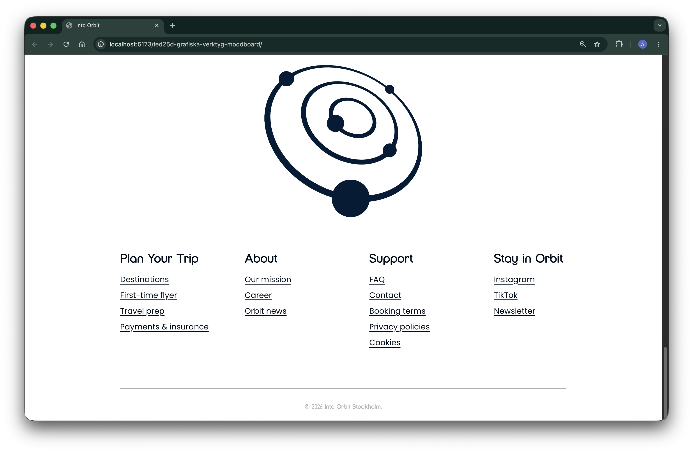

# Into Orbit

[](https://vitejs.dev/) [](https://sass-lang.com/) [](https://developer.mozilla.org/en-US/docs/Web/JavaScript) [](https://eslint.org/) 

[🚀 View Live Project](https://medieinstitutet.github.io/fed25d-grafiska-verktyg-moodboard/)

## Overview

Into Orbit is a responsive moodboard project for a premium space travel brand. The design aims to feel cinematic, futuristic, and easy to scan while still keeping the interface clean and accessible.

## Features / Highlights

- Responsive layout for mobile, tablet, and desktop
- Interactive space map with hover and focus states
- Custom typography using Goodspace Rounded for headings and Poppins for body text
- Clean section-based layout for easy scanning and navigation
- Branded color palette and visuals that match the space travel concept

## Tech Stack

- HTML
- CSS
- Vite
- SCSS
- Vanilla JavaScript
- SVG, WebP, JPG, and custom font assets
- Figma

## Screenshots

- GIF and screenshots of the live site, showing the design and interactions in action.


- Screenshots of the live site, showing the design and interactions in action.







## Developers

- Kimi - [Prxjec-t](https://github.com/Prxjec-t)
- Angelie - [ngeliecode](https://github.com/ngeliecode)
- Maria - [mariabhai](https://github.com/mariabhai)
- Alex - [alexminhtruong](https://github.com/alexminhtruong)

## Getting Started

Install dependencies and start the dev server:

```bash
npm install
npm run dev
```

## Scripts

- `npm run dev` - start the Vite development server
- `npm run build` - create a production build
- `npm run preview` - preview the production build locally

## Project Structure

- `src/main.js` - application entry point
- `src/styles/` - SCSS source files and shared variables
- `public/` - static assets served directly by Vite
- `public/assets/` - project images, icons, fonts, and other static design assets

## Design Reference

The original Figma design and prototype were used as the visual reference for the moodboard and interactions.

- [Open the Figma design](https://www.figma.com/design/ZPbQt4fZ07pghM9mvb9MO1/into-orbit?node-id=262-2158&t=HlhPd3pJeQi035qX-1)
- [Open the Figma prototype](https://www.figma.com/proto/ZPbQt4fZ07pghM9mvb9MO1/into-orbit?node-id=169-578&t=d6brvQ8UDzwErvFC-1&scaling=scale-down&content-scaling=fixed&page-id=15%3A76&starting-point-node-id=169%3A578&show-proto-sidebar=1)

## Naming Conventions

- kebab-case for class names in HTML and files
- IDs currently use a mix of kebab-case (for example, `space-map`) and camelCase (for example, `menuToggle`)
- Branch names should follow the example `feature/branchname` format.
